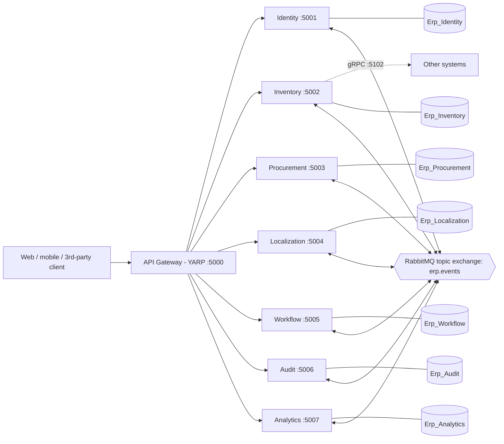
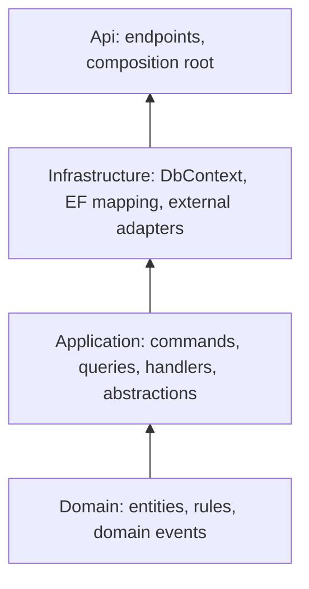
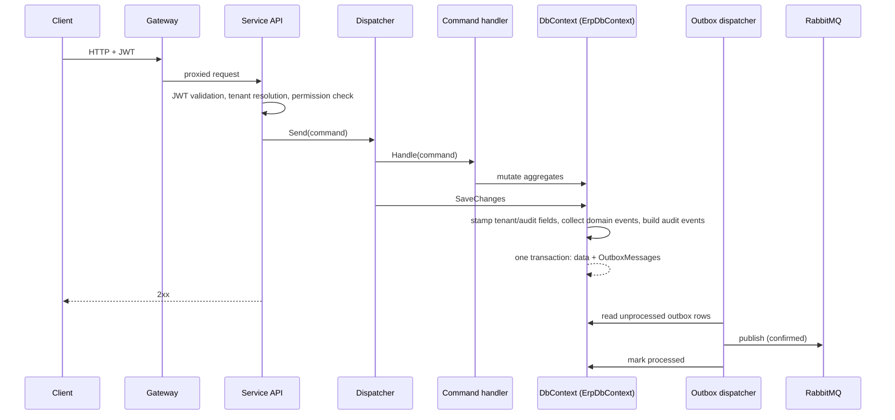
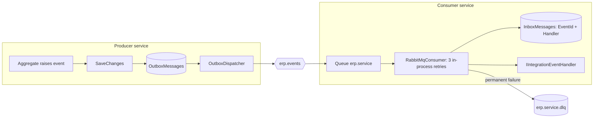
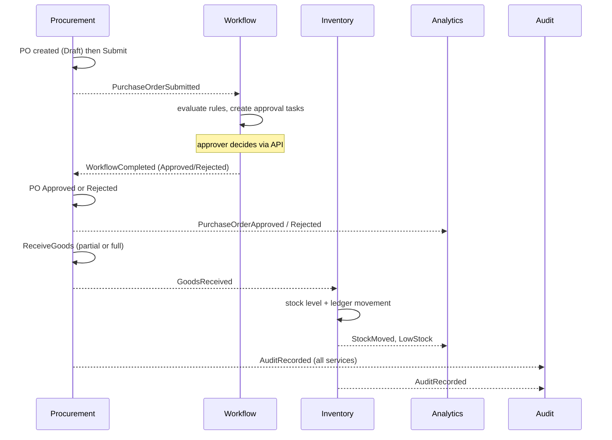

# Multi-Tenant Event-Driven ERP Microservices Platform

A cloud-native ERP backend built on **.NET 10**, **microservices**, **Clean Architecture**, **CQRS** and **EF Core code-first** with SQL Server and RabbitMQ.

> **Status:** the code was written without access to a .NET SDK or NuGet, so it has **not been compiled, run or tested**. Package versions were set from memory. Treat the first build as a fix-up pass (build → fix compile errors → generate migrations → run). Everything below describes what the code is designed to do, not behaviour verified at runtime.

---

## Table of contents
1. [Capabilities](#1-capabilities)
2. [Technology stack](#2-technology-stack)
3. [Architecture](#3-architecture)
4. [Cross-cutting building blocks](#4-cross-cutting-building-blocks)
5. [Services](#5-services)
6. [Event catalogue](#6-event-catalogue)
7. [Security model](#7-security-model)
8. [Setup](#8-setup)
9. [Configuration reference](#9-configuration-reference)
10. [Database and migrations](#10-database-and-migrations)
11. [End-to-end walkthrough](#11-end-to-end-walkthrough)
12. [Testing](#12-testing)
13. [Adding a new module](#13-adding-a-new-module)
14. [Design decisions and trade-offs](#14-design-decisions-and-trade-offs)
15. [Known gaps](#15-known-gaps)
16. [Troubleshooting](#16-troubleshooting)
17. [Repository layout](#17-repository-layout)

---

## 1. Capabilities

| Capability | How it is delivered |
|---|---|
| Centralised data, atomic updates | One database per service; every command commits data + outbox + audit rows in a single transaction. Cross-service consistency is eventual, via events. |
| Extensible modular architecture | Each module is an independent service (4 projects). Modules never call each other synchronously; they exchange versionless event contracts. Gateway routes are configuration. |
| REST and gRPC APIs | Minimal-API REST in every service, OpenAPI documents, a gRPC `StockQuery` service, a SignalR hub for live stock. |
| Programmable workflow automation | Versioned workflow definitions, JSON rule conditions, sequential approval steps, segregation of duties. |
| Analytics and BI | Event-fed daily KPI read model, role-based dashboards, time-series and exponential-smoothing forecast. |
| Granular security | Permission-based RBAC, JWT, TOTP multi-factor authentication, lockout, refresh-token rotation, AES-GCM field encryption. |
| Immutable audit trail | Hash-chained audit log per tenant, verification endpoint, database trigger blocking UPDATE/DELETE. |
| Multi-tenancy | Shared database with `TenantId` discriminator, global query filters, tenant taken from the access token. |
| Internationalisation | Currencies, hourly exchange-rate refresh, cross-rate conversion, configurable tax rules, translations with culture fallback. |
| Inventory and supply chain | Stock levels with weighted-average cost, append-only ledger, reservations, transfers, adjustments, shipments with tracking history, goods receipt from procurement. |

---

## 2. Technology stack

| Concern | Choice |
|---|---|
| Runtime / framework | .NET 10, ASP.NET Core minimal APIs |
| Persistence | EF Core 10, SQL Server (code-first, migrations) |
| Messaging | RabbitMQ (topic exchange, publisher confirms, dead-letter queues) via `RabbitMQ.Client` 7.x |
| Gateway | YARP reverse proxy |
| RPC / realtime | gRPC (`Grpc.AspNetCore`), SignalR |
| AuthN / AuthZ | JWT bearer (HS256), custom permission policy provider |
| Passwords | `PasswordHasher` (PBKDF2) from `Microsoft.Extensions.Identity.Core` |
| API docs | `Microsoft.AspNetCore.OpenApi` |
| Containers | Docker, Docker Compose |
| Tests | xUnit |
| CQRS | Small in-house dispatcher (no MediatR, avoiding its commercial licence) |

---

## 3. Architecture

### 3.1 System view



Each service owns its database. There are no cross-service joins or foreign keys; services reference each other by GUID only.

### 3.2 Layering inside every service (Clean Architecture)



Dependencies point inward: `Api → Infrastructure → Application → Domain`.

| Layer | Contains | Depends on |
|---|---|---|
| `Erp.<X>.Domain` | Aggregates, value rules, enums, integration events raised by aggregates | Building blocks (domain), contracts |
| `Erp.<X>.Application` | `ICommand`/`IQuery` records, handlers, DTOs, `I<X>DbContext` | Domain, EF Core abstractions |
| `Erp.<X>.Infrastructure` | `<X>DbContext`, entity configuration, adapters (e.g. exchange-rate provider, TOTP, token service) | Application |
| `Erp.<X>.Api` | Endpoint mapping, `Program.cs`, `appsettings.json` | Infrastructure, building blocks (web) |

Pragmatic choice: the Application layer talks to an `I<X>DbContext` interface that exposes `DbSet<T>` instead of a repository per aggregate. This removes a large amount of boilerplate and is a common Clean Architecture variant; the cost is that the Application layer references EF Core.

### 3.3 Request flow (command)



Key point: the dispatcher commits **after** the handler returns, so every command is one transaction containing the data change, the outbox rows (integration events) and the audit events.

### 3.4 Reliable messaging



- **Producer:** transactional outbox, at-least-once delivery, publisher confirms.
- **Consumer:** one queue per service bound to the event types it handles; handler effects and the inbox row commit together, which makes consumers idempotent; after 3 failed attempts the message is dead-lettered.
- Routing key = event type name (e.g. `PurchaseOrderSubmittedEvent`).

### 3.5 Purchase-to-stock flow across services



---

## 4. Cross-cutting building blocks

All five shared projects live in `src/BuildingBlocks`.

| Project | Responsibility |
|---|---|
| `Erp.BuildingBlocks.Domain` | `Entity`, `AuditableEntity`, `TenantEntity`, `IntegrationEvent`, exceptions (`DomainException`, `NotFoundException`, `ConflictException`, `ForbiddenException`), `Guard` helpers |
| `Erp.BuildingBlocks.Application` | CQRS abstractions, `IDispatcher` implementation, `ITenantContext`, `ICurrentUser`, `IEventBus`, `PagedResult<T>`, `JwtOptions`, handler auto-registration |
| `Erp.BuildingBlocks.Infrastructure` | `ErpDbContext`, outbox/inbox, RabbitMQ bus + consumer + outbox dispatcher, `FieldEncryption`, `TenantContext`, `CurrentUser`, `DatabaseInitializer` |
| `Erp.BuildingBlocks.Web` | `AddErpService<TContext>()` / `UseErpService()`, JWT setup, permission policies, tenant and access-audit middleware, global exception handler, rate limiting, health checks, OpenAPI |
| `Erp.Contracts` | Integration event records and the permission catalogue `Perm` |

### 4.1 `ErpDbContext` (base of every service context)
Provides automatically:
- **Tenant isolation:** global query filter on every `ITenantScoped` entity; `TenantId` is stamped on insert and an insert without a tenant fails.
- **Soft delete:** `Remove()` on an `ISoftDeletable` entity becomes `IsDeleted = true` (filter hides it).
- **Audit stamps:** `CreatedAtUtc/By`, `ModifiedAtUtc/By`.
- **Optimistic concurrency:** `RowVersion` token on all auditable entities (concurrent edits return HTTP 409).
- **Outbox:** integration events raised by aggregates, plus one `AuditRecordedEvent` per changed row, are written to `OutboxMessages` in the same transaction. Sensitive columns (names containing password, secret, token, hash) are redacted as `***`.
- **Conventions:** decimals `(18,4)`, strings `nvarchar(256)` by default, client-generated GUID keys (`ValueGeneratedNever`).

### 4.2 CQRS dispatcher
Commands implement `ICommand<TResult>`, queries `IQuery<TResult>`. Handlers are discovered by assembly scanning. `Send()` runs the handler then calls `SaveChanges`; `Query()` does not save. Failures that must be persisted (for example failed-login counters) are returned as a result value rather than thrown, because exceptions skip the save.

### 4.3 Error handling
`GlobalExceptionHandler` converts exceptions to RFC 7807 problem details:

| Exception | HTTP |
|---|---|
| `NotFoundException` | 404 |
| `DomainException` | 422 |
| `ForbiddenException` | 403 |
| `ConflictException`, `DbUpdateException` (incl. concurrency) | 409 |
| `UnauthorizedAccessException` | 401 |
| anything else | 500 (generic message, details logged) |

### 4.4 Service defaults
`builder.AddErpService<TContext>("name", applicationAssembly)` registers the DbContext, unit of work, tenant and user services, handlers, messaging, JWT authentication, permission authorization, problem details, OpenAPI, health checks (`/health/live`, `/health/ready`), CORS and a per-tenant rate limiter. `app.UseErpService()` builds the middleware pipeline in the correct order.

---

## 5. Services

Ports: gateway **5000**, identity **5001**, inventory **5002** (gRPC **5102**), procurement **5003**, localization **5004**, workflow **5005**, audit **5006**, analytics **5007**. Database names: `Erp_<Service>`.

### 5.1 Identity
**Purpose:** tenants, users, roles, authentication, MFA.

| Entity | Notes |
|---|---|
| `Tenant` | code (unique), default currency/culture; raises `TenantRegisteredEvent` |
| `User` | e-mail unique per tenant, password hash, lockout (5 failures → 15 min), MFA secret (encrypted at rest), role ids |
| `Role` | permission list; the built-in `Administrator` role holds the wildcard `*` |
| `RefreshToken` | stored as SHA-256 hash, rotated on every use; reuse of a rotated token revokes the user's whole token family |

| Method | Route | Auth |
|---|---|---|
| POST | `/api/tenants` | `X-Platform-Key` header (platform operator) |
| POST | `/api/auth/login` | anonymous (tenant code + e-mail + password [+ MFA code]) |
| POST | `/api/auth/refresh` | anonymous (refresh token) |
| POST | `/api/auth/mfa/setup`, `/api/auth/mfa/enable` | authenticated |
| GET/POST | `/api/users`, PUT `/api/users/{id}/roles` | `identity.users.*` |
| GET/POST | `/api/roles`, GET `/api/permissions` | `identity.roles.*` |

Login responses: `200` tokens, `401 MfaRequired` / `InvalidCredentials`, `423 LockedOut`.

### 5.2 Inventory
**Purpose:** products, warehouses, stock, movements, shipments.

| Entity | Notes |
|---|---|
| `Product` | SKU unique per tenant, cost, reorder level |
| `Warehouse` | code unique per tenant |
| `StockLevel` | product × warehouse; on-hand, reserved, available, moving weighted-average cost; row-version protected |
| `StockMovement` | append-only ledger (Receipt, Issue, TransferOut/In, AdjustmentIn/Out) with balance after each movement |
| `Shipment` | carrier, tracking number, status history (Planned → PickedUp → InTransit → OutForDelivery → Delivered / Exception / Cancelled) |

All balance changes go through `StockService.ApplyAsync`, which updates the level, appends the ledger row and raises `StockMovedEvent` (and `LowStockEvent` when available ≤ reorder level).

| Method | Route |
|---|---|
| GET/POST | `/api/products`, `/api/warehouses` |
| GET | `/api/stock/levels`, `/api/stock/movements` |
| POST | `/api/stock/receive`, `/issue`, `/transfer`, `/adjust`, `/reserve` |
| POST | `/api/shipments`, `/api/shipments/{id}/status` |
| GET | `/api/shipments/track/{trackingNumber}` |
| SignalR | `/hubs/stock` (event `stockMoved`, grouped per tenant; JWT via `access_token` query string) |
| gRPC | `erp.inventory.StockQuery/GetAvailable` on port 5102 (HTTP/2, JWT) |

Consumes: `GoodsReceivedEvent` (books stock), `StockMovedEvent` (pushes to SignalR).

### 5.3 Procurement
**Purpose:** suppliers and purchase orders.

Purchase order states: `Draft → PendingApproval → Approved → PartiallyReceived → Received`, plus `Rejected` and `Cancelled`. Rules enforced in the aggregate: lines only editable in Draft, at least one line to submit, goods only received against approved orders, received quantity cannot exceed outstanding quantity, totals include tax per line.

| Method | Route |
|---|---|
| GET/POST | `/api/suppliers` |
| GET/POST | `/api/purchase-orders`, GET `/api/purchase-orders/{id}` |
| POST | `/{id}/submit`, `/{id}/cancel`, `/{id}/receive` |

Publishes: `PurchaseOrderSubmitted`, `PurchaseOrderApproved`, `PurchaseOrderRejected`, `GoodsReceived`. Consumes: `WorkflowCompleted`.

### 5.4 Localization
**Purpose:** currencies, exchange rates, tax, translations.

- **Exchange rates:** a background job pulls ECB reference rates from `api.frankfurter.dev` (default every 60 minutes, base `EUR`). Conversion uses the latest rate on or before the requested date and cross-rates through the base: `amount / rate(from) × rate(to)`. Replace `FrankfurterRateProvider` to use another provider.
- **Tax engine:** tenant-defined rules by country, optional region, category and validity window; priority-ordered; stacked or compound; supports tax-inclusive prices (solved algebraically). Rates are fractions (`0.18` = 18 %).
- **Translations:** key + culture; resolution order exact culture → neutral culture → `en`. Reading translations is anonymous so a UI can load before login.

| Method | Route |
|---|---|
| GET/PUT | `/api/currencies` |
| GET | `/api/exchange-rates/convert?from=&to=&amount=&asOf=` |
| POST | `/api/exchange-rates/refresh` |
| GET | `/api/tax/calculate?country=&region=&category=&amount=&inclusive=` |
| GET/POST | `/api/tax/rules` |
| GET | `/api/translations/{culture}` (anonymous) |
| PUT | `/api/translations` |

### 5.5 Workflow
**Purpose:** rule-based approval chains.

- **Definition:** code, entity type, ordered steps; each step has an approver role or user and an optional condition list. New definition with an existing code creates a new version and deactivates the old one; running instances are unaffected.
- **Rules:** JSON array, all conditions AND-ed, e.g. `[{"field":"totalAmount","operator":"gt","value":10000}]`. Operators: `eq, ne, gt, gte, lt, lte, contains, in`. Field names are case-insensitive and may use dotted paths.
- **Instance:** steps whose rules do not match are skipped. No definition for the entity type, or no matching step, means the request is **auto-approved**. A rejection ends the workflow immediately.
- **Segregation of duties:** the person who started the request cannot decide it.

| Method | Route |
|---|---|
| GET/POST | `/api/workflows/definitions` |
| POST | `/api/workflows/instances` |
| GET | `/api/workflows/instances/{id}`, `/instances/by-entity`, `/tasks/mine` |
| POST | `/instances/{id}/decision`, `/instances/{id}/cancel` |

Consumes `PurchaseOrderSubmitted` (starts the chain); publishes `WorkflowCompleted`.

### 5.6 Audit
**Purpose:** tamper-evident record of who changed what and who accessed what.

- Every service sends one `AuditRecordedEvent` per changed row (field-level old/new values) and per authenticated API call (method, path, status, user, IP).
- Entries are appended to a **per-tenant hash chain**: `Hash = SHA-256(previousHash | tenant | service | entity | id | action | changes | user | ip | time)`.
- A unique index on `(TenantId, PreviousHash)` makes forks of the chain impossible; a unique index on `EventId` makes ingestion idempotent.
- `GET /api/audit/verify` walks the chain and reports the first broken row, if any (modified row or removed/reordered row).
- The context refuses UPDATE/DELETE in code; `scripts/sql/audit-immutability.sql` adds an `INSTEAD OF UPDATE, DELETE` trigger so even direct SQL cannot rewrite history. Also grant the audit service login only INSERT and SELECT.

| Method | Route |
|---|---|
| GET | `/api/audit` (filters: entityType, entityId, action, userId, from, to, paging) |
| GET | `/api/audit/verify` |

### 5.7 Analytics
**Purpose:** KPI read model, dashboards, forecasts.

| KPI code | Source event | Dimension |
|---|---|---|
| `stock.received.qty` | `StockMoved` (Receipt) | SKU |
| `stock.issued.qty` | `StockMoved` (Issue) | SKU |
| `procurement.po.approved.count` / `.value` | `PurchaseOrderApproved` | currency |
| `procurement.po.rejected.count` | `PurchaseOrderRejected` | all |
| `inventory.lowstock.alerts` | `LowStock` | SKU |

- **Series:** zero-filled daily series per KPI/dimension.
- **Forecast:** simple exponential smoothing; the response includes the smoothing factor, number of days with data, the in-sample mean absolute error, and a warning when fewer than 14 days contain data. It is a baseline, not a demand-planning model.
- **Dashboards:** a dashboard definition maps a role to a list of KPIs; `GET /dashboards/mine` returns last-30-day totals, change against the previous 30 days, and a sparkline for the caller's roles.

| Method | Route |
|---|---|
| GET | `/api/analytics/kpis`, `/series`, `/forecast`, `/dashboards/mine` |
| PUT | `/api/analytics/dashboards` |

### 5.8 API Gateway
YARP routes by path prefix to each service; WebSocket traffic for `/hubs/*` is proxied. Routes and clusters live in `src/Gateway/Erp.Gateway/appsettings.json`; remove a route to unplug a module. JWT validation happens in the services, the gateway forwards the `Authorization` header.

---

## 6. Event catalogue

| Event | Raised by | Consumed by |
|---|---|---|
| `AuditRecordedEvent` | every service (entity changes, API access) | Audit |
| `TenantRegisteredEvent` | Identity | (no consumer yet, available for provisioning hooks) |
| `PurchaseOrderSubmittedEvent` | Procurement | Workflow |
| `WorkflowCompletedEvent` | Workflow | Procurement |
| `PurchaseOrderApprovedEvent` | Procurement | Analytics |
| `PurchaseOrderRejectedEvent` | Procurement | Analytics |
| `GoodsReceivedEvent` | Procurement | Inventory |
| `StockMovedEvent` | Inventory | Inventory (SignalR), Analytics |
| `LowStockEvent` | Inventory | Analytics |

Every event carries `EventId`, `OccurredAtUtc` and `TenantId`. Contracts live in `Erp.Contracts/IntegrationEvents.cs`. Treat them as public contracts: add fields, do not rename or remove.

---

## 7. Security model

| Area | Mechanism |
|---|---|
| Authentication | JWT bearer, 15-minute access token, 14-day rotating refresh token (hashed in DB) |
| MFA | TOTP (RFC 6238, SHA-1, 6 digits, 30 s) compatible with Google/Microsoft Authenticator; ±1 step drift tolerated |
| Passwords | PBKDF2 via ASP.NET `PasswordHasher`; minimum 12 characters; 5 failures → 15-minute lockout |
| Authorisation | Permission claims; `RequirePermission("inventory.stock.write")` on endpoints; `*` is the administrator wildcard; permission catalogue is `Erp.Contracts/Permissions.cs` |
| Tenant isolation | Tenant id from the `tenant_id` claim; `X-Tenant-Id` header honoured only for unauthenticated calls (login) and rejected if it conflicts with the claim; EF global query filters |
| Data in transit | TLS expected at ingress or Kestrel (`Security:RequireHttps` enables HSTS + redirect) |
| Data at rest | SQL Server TDE (infrastructure) plus AES-256-GCM field encryption for secrets (key from `Encryption:Key`, base64, 32 bytes) |
| Abuse control | Per-tenant fixed-window rate limit (`RateLimit:PermitPerMinute`, default 600) |
| Segregation of duties | Workflow blocks requesters from approving their own request |
| Audit | See [5.6](#56-audit) |

**Before any non-local use:** replace `Jwt:SigningKey`, `Encryption:Key`, `Platform:ApiKey` and the SQL password with secrets from a vault; enable HTTPS; restrict CORS origins.

---

## 8. Setup

### 8.1 Prerequisites
- .NET 10 SDK
- Docker (for SQL Server and RabbitMQ), or your own instances
- `dotnet tool restore` installs `dotnet-ef` 10.0.0 (declared in `.config/dotnet-tools.json`)

### 8.2 Quick start with Docker Compose
```bash
cp .env.example .env            # change the values
docker compose up --build       # SQL Server, RabbitMQ, 7 services, gateway
```
Services auto-migrate on start (`Database:AutoMigrate=true`). If no migrations exist yet they fall back to `EnsureCreated` (development only).

Start only some modules:
```bash
docker compose up sqlserver rabbitmq identity inventory gateway
```
RabbitMQ management UI: http://localhost:15672 (guest/guest).

### 8.3 Local development (services via `dotnet run`)
```bash
docker compose up -d sqlserver rabbitmq
dotnet tool restore
dotnet build ErpPlatform.slnx

scripts/init-migrations.sh          # Windows: scripts/init-migrations.ps1   (once)
scripts/update-database.sh          # or rely on AutoMigrate

dotnet run --project src/Services/Identity/Erp.Identity.Api
dotnet run --project src/Services/Inventory/Erp.Inventory.Api
dotnet run --project src/Services/Procurement/Erp.Procurement.Api
dotnet run --project src/Services/Localization/Erp.Localization.Api
dotnet run --project src/Services/Workflow/Erp.Workflow.Api
dotnet run --project src/Services/Audit/Erp.Audit.Api
dotnet run --project src/Services/Analytics/Erp.Analytics.Api
dotnet run --project src/Gateway/Erp.Gateway
```
OpenAPI documents (Development): `http://localhost:<port>/openapi/v1.json`.

### 8.4 First tenant and login
```bash
curl -X POST http://localhost:5000/api/tenants \
  -H "X-Platform-Key: dev-platform-key-change-me" -H "Content-Type: application/json" \
  -d '{"code":"acme","name":"Acme Ltd","defaultCurrency":"USD","defaultCulture":"en",
       "adminEmail":"admin@acme.test","adminFullName":"Admin","adminPassword":"ChangeMe-12345"}'

curl -X POST http://localhost:5000/api/auth/login -H "Content-Type: application/json" \
  -d '{"tenantCode":"acme","email":"admin@acme.test","password":"ChangeMe-12345"}'
# use accessToken as: Authorization: Bearer <token>
```

---

## 9. Configuration reference

Set in each service's `appsettings.json`, or as environment variables using `__` (e.g. `Jwt__SigningKey`).

| Key | Default | Purpose |
|---|---|---|
| `ConnectionStrings:Default` | local SQL Server, db `Erp_<Service>` | database |
| `RabbitMq:Host/Port/User/Password/Exchange` | localhost / 5672 / guest / guest / `erp.events` | broker |
| `Jwt:Issuer`, `Audience`, `SigningKey` | dev values | token validation (identical in all services) |
| `Jwt:AccessTokenMinutes`, `RefreshTokenDays` | 15, 14 | token lifetimes |
| `Encryption:Key` | dev key | base64 32-byte AES key (identical across services that decrypt the same data) |
| `Database:AutoMigrate` | `true` | apply migrations at start-up |
| `Audit:LogAccess` | `true` | publish an audit event per authenticated API call |
| `RateLimit:PermitPerMinute` | 600 | per-tenant (or per-IP) limit |
| `Security:RequireHttps` | `false` | HSTS + HTTPS redirect |
| `Cors:Origins` | `http://localhost:4200` | allowed browser origins |
| `OpenApi:Enabled` | `false` outside Development | expose `/openapi/v1.json` |
| `Platform:ApiKey` (Identity) | dev key | tenant onboarding |
| `Localization:BaseCurrency`, `RefreshMinutes`, `RatesApiUrl` | EUR, 60, frankfurter | rate refresh |

---

## 10. Database and migrations

Code-first: the schema is defined entirely by the Domain entities and the `ConfigureModel` method of each `<X>DbContext`.

| Task | Command |
|---|---|
| First migration for all services | `scripts/init-migrations.sh` (or `.ps1`) |
| New migration for one service | `scripts/add-migration.sh Inventory AddSerialNumbers` |
| Apply all / one service | `scripts/update-database.sh` / `scripts/update-database.sh Inventory` |
| Apply at start-up | `Database:AutoMigrate=true` (default) |

Notes:
- Migrations live in `Erp.<X>.Infrastructure/Migrations`; commit them.
- The EF tooling uses the Api project as startup project, so connection strings come from its `appsettings.json`.
- Each context also contains `OutboxMessages` and `InboxMessages` tables.
- Audit: after the first Audit migration run `scripts/sql/audit-immutability.sql` (or embed it in a migration with `migrationBuilder.Sql`).
- Unique indexes on tenant-scoped master data carry the filter `[IsDeleted] = 0` so soft-deleted rows do not block re-use of codes.
- In production prefer generating SQL scripts (`dotnet ef migrations script`) and applying them in the deployment pipeline over auto-migration.

---

## 11. End-to-end walkthrough

1. Create tenant and log in (8.4). Use the admin token for all calls below.
2. `POST /api/warehouses` → `{ "code":"MAIN","name":"Main warehouse" }`.
3. `POST /api/products` → SKU `WID-001`, reorder level 20; note the returned ids.
4. `POST /api/suppliers`.
5. `POST /api/workflows/definitions` with entity type `PurchaseOrder` and steps, for example:
   ```json
   { "code":"po-approval","name":"PO approval","entityType":"PurchaseOrder","steps":[
     {"order":1,"name":"Manager","approverRole":"Administrator"},
     {"order":2,"name":"Director","approverRole":"Administrator",
      "conditionsJson":"[{\"field\":\"totalAmount\",\"operator\":\"gt\",\"value\":10000}]"} ] }
   ```
6. `POST /api/purchase-orders` with lines, then `POST /api/purchase-orders/{id}/submit`.
7. Wait a second; `GET /api/workflows/tasks/mine` shows the approval task. Approve with `POST /api/workflows/instances/{id}/decision` using a **different user** than the requester (segregation of duties).
8. `GET /api/purchase-orders/{id}` shows `Approved`.
9. `POST /api/purchase-orders/{id}/receive` with line ids and quantities.
10. `GET /api/stock/levels` shows the received stock; `GET /api/stock/movements?productId=…` shows the ledger.
11. `GET /api/audit?entityType=StockLevel` and `GET /api/audit/verify` show the trail and chain status.
12. `GET /api/analytics/series?code=stock.received.qty` shows the KPI.

---

## 12. Testing

`tests/Erp.UnitTests` (xUnit) covers pure logic: weighted-average cost and stock guards, purchase-order totals and receiving rules, workflow rule evaluation and approval chain, tax maths (stacked, inclusive, compound), audit hash chain, forecast smoothing.

```bash
dotnet test
```
Not yet covered: handlers against a real database, messaging, authentication flows, gateway. A sensible next step is integration tests with Testcontainers (SQL Server, RabbitMQ).

---

## 13. Adding a new module

Example: CRM.
1. Create `src/Services/Crm/Erp.Crm.{Domain,Application,Infrastructure,Api}` following an existing service (copy the csproj files and global usings).
2. Domain: entities deriving from `TenantEntity`; raise integration events with `Raise(...)`.
3. Application: `ICrmDbContext : IUnitOfWork`, command/query records and internal handlers (auto-registered).
4. Infrastructure: `CrmDbContext : ErpDbContext, ICrmDbContext` with `ConfigureModel`.
5. Api: `builder.AddErpService<CrmDbContext>("crm", typeof(ICrmDbContext).Assembly);` register `ICrmDbContext`, call `InitializeDatabaseAsync`, `UseErpService()`, map endpoints with `RequirePermission(...)`.
6. Add permission constants to `Erp.Contracts/Permissions.cs` and event records to `IntegrationEvents.cs`.
7. Add a route and cluster to the gateway, a service block to `docker-compose.yml`, the project to the `.slnx`, and the service name to the migration scripts.

Tenancy, audit, outbox/inbox, authentication, authorisation, health checks and error handling come from the building blocks without extra code.

---

## 14. Design decisions and trade-offs

| Decision | Reason | Cost |
|---|---|---|
| Database per service | Independent scaling and deployment, enforced module boundaries | No cross-service transactions or joins; consistency is eventual; reporting needs the Analytics read model |
| Transactional outbox + idempotent inbox | No lost or phantom events without distributed transactions | At-least-once delivery, small publish latency (about 1 s polling) |
| Shared database, discriminator column for tenancy | Cheapest operationally, simple migrations | Noisy-neighbour and compliance limits; large or regulated tenants may need a database per tenant |
| In-house CQRS dispatcher | No third-party licence risk, about 60 lines | No pipeline behaviours (validation, logging) out of the box |
| `DbSet` exposed through an Application interface | Far less boilerplate than repositories | Application layer references EF Core |
| Domain events double as integration events | Fewer types | Domain model is coupled to the public contract; split them if contracts must evolve independently |
| Hash-chained audit with DB trigger | Tamper evidence plus prevention | One writer per tenant chain is assumed (run Audit as a single instance) |
| Symmetric JWT | Simple to set up | Every service holds the signing key; move to asymmetric keys / JWKS for production |
| Soft delete everywhere | Recoverability, audit friendliness | Larger tables; indexes need `IsDeleted` filters |

---

## 15. Known gaps

- **Not built:** CRM, HR, Finance/general ledger, Manufacturing/BOM modules; customer-facing sales and order management.
- **Not verified:** the solution has never been compiled or executed; RabbitMQ 7.x API usage and EF Core mapping of owned collections are the likeliest places for fixes.
- **Security hardening:** keys in configuration instead of a vault/KMS, symmetric JWT, no Data Protection key ring, no per-endpoint MFA enforcement policy.
- **Scale-out:** outbox polling has no row locking (run one replica per service or add `UPDLOCK/READPAST`); SignalR needs a backplane for more than one Inventory instance; Audit must be single-instance.
- **Compliance:** GDPR erasure conflicts with immutability; keep personal data out of audit payloads (store ids) or add crypto-shredding.
- **Operations:** no OpenTelemetry tracing/metrics, no CI/CD pipeline, no integration or load tests, no Kubernetes manifests.
- **Business logic:** purchase-order tax rates are supplied by the client (call the tax endpoint first); landed costs, serial/lot tracking, multi-level approvals by amount per currency, and procurement-to-invoice matching are not implemented.

---

## 16. Troubleshooting

| Symptom | Likely cause / fix |
|---|---|
| `401` on every call | Token issued with a different `Jwt:SigningKey`/`Issuer`/`Audience` than the service validates; keys must match across services |
| `403 Tenant mismatch` | `X-Tenant-Id` header differs from the token's tenant; remove the header on authenticated calls |
| Service exits with "Encryption:Key is missing" or "must be 32 bytes" | Provide a base64 string that decodes to exactly 32 bytes (`openssl rand -base64 32`) |
| Events not arriving | Check RabbitMQ is up, `OutboxMessages` rows have `ProcessedAtUtc`, queue `erp.<service>` exists and is bound; failed messages sit in `erp.<service>.dlq` |
| PO stays `PendingApproval` | Workflow service not running or no matching approver; check `/api/workflows/tasks/mine` and the workflow queue |
| `409 Conflict` on stock operations | Concurrent update of the same stock level; retry the request |
| `Database not ready` warnings at start | SQL Server still booting; the initializer retries up to 12 times (5 s apart) |
| gRPC call fails | gRPC needs the HTTP/2-only endpoint on port 5102, not the REST port; use JWT metadata `authorization: Bearer …` |
| `EnsureCreated` warning, later migration conflicts | The database was created without migrations; drop it and run `init-migrations` then `update-database` |
| No exchange rates | First refresh runs 15 s after start; call `POST /api/exchange-rates/refresh`; check outbound access to the rates API |

---

## 17. Repository layout

```
ErpPlatform/
├─ ErpPlatform.slnx
├─ Directory.Build.props / Directory.Packages.props / global.json
├─ docker-compose.yml · Dockerfile · .env.example
├─ .config/dotnet-tools.json            (dotnet-ef)
├─ scripts/                             migrations (sh + ps1), sql/audit-immutability.sql
├─ docs/                                this document
├─ src/
│  ├─ BuildingBlocks/
│  │  ├─ Erp.BuildingBlocks.Domain
│  │  ├─ Erp.BuildingBlocks.Application
│  │  ├─ Erp.BuildingBlocks.Infrastructure
│  │  ├─ Erp.BuildingBlocks.Web
│  │  └─ Erp.Contracts
│  ├─ Gateway/Erp.Gateway
│  └─ Services/
│     ├─ Identity      (Domain · Application · Infrastructure · Api)
│     ├─ Inventory     (… + Grpc/inventory.proto, SignalR hub)
│     ├─ Procurement
│     ├─ Localization
│     ├─ Workflow
│     ├─ Audit
│     └─ Analytics
└─ tests/Erp.UnitTests
```
